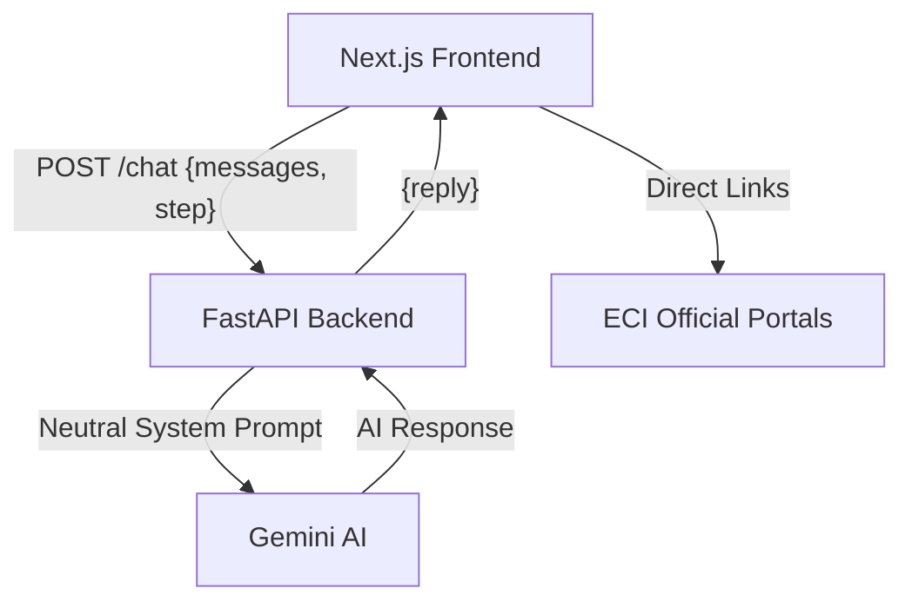

# VoteReady 🗳️

[](https://nextjs.org/)
[](https://fastapi.tiangolo.com/)
[](https://aistudio.google.com/)
[](https://opensource.org/licenses/MIT)

> A beginner-friendly, politically neutral election guide for first-time Indian voters (ages 18–25).

VoteReady simplifies the Indian electoral process into a digestible, mobile-first experience. It combines a structured 8-step guide with an AI assistant to ensure new voters feel confident and informed before they head to the polling booth.

[**Explore the Live Demo**](https://your-vercel-url.vercel.app) 🚀

---

## ✨ Key Features

- 🚶 **8-Step Voting Journey**: From eligibility checks to the final ink mark, with interactive progress tracking.
- 🤖 **Context-Aware AI Assistant**: Powered by Gemini 2.5 Flash, the assistant knows exactly where you are in the guide and provides neutral, on-topic support.
- 🔗 **Direct ECI Integration**: Quick access to official Election Commission of India portals for registration, e-EPIC, and candidate affidavits.
- 📱 **Mobile-First Design**: Smooth swipe gestures for navigation and an intuitive bottom-sheet chat interface.
- ⚖️ **Strict Neutrality**: Built-in safeguards to ensure the AI remains non-partisan and focused solely on voter education.

---

## 🛠️ Tech Stack

| Layer | Technology | Deployment |
| :--- | :--- | :--- |
| **Frontend** | Next.js 15 (App Router), Tailwind CSS, Lucide React | [Vercel](https://vercel.com) |
| **Backend** | FastAPI (Python 3.10+), Pydantic | [Render](https://render.com) |
| **AI Engine** | Google Gemini 2.5 Flash (`google-genai`) | [Google AI Studio](https://aistudio.google.com/) |

---

## 🏗️ Architecture



---

## 🚀 Local Setup

### 1. Prerequisites
- Node.js 18+
- Python 3.10+
- [Google AI Studio API Key](https://aistudio.google.com/apikey)

### 2. Backend Setup
```bash
cd backend
python -m venv .venv
# Windows
.venv\Scripts\activate
# macOS/Linux
source .venv/bin/activate

pip install -r requirements.txt
cp .env.example .env
# Edit .env and add your GEMINI_API_KEY
uvicorn main:app --reload --port 8000
```

### 3. Frontend Setup
```bash
# In the repository root
npm install
cp .env.example .env.local
# Set NEXT_PUBLIC_API_URL=http://localhost:8000
npm run dev
```
Open [http://localhost:3000](http://localhost:3000) to view the app.

---

## 🚢 Deployment

### Backend (Render)
1. Go to your [Render Dashboard](https://dashboard.render.com).
2. Click **New** → **Blueprint** and connect this repository.
3. It will automatically detect `render.yaml`.
4. Configure environment variables: `GEMINI_API_KEY`.
5. Deploy and note your backend URL.

### Frontend (Vercel)
1. Push your code to GitHub.
2. Import the project into [Vercel](https://vercel.com).
3. Add the Environment Variable `NEXT_PUBLIC_API_URL` (set to your Render URL).
4. Deploy!

---

## 📸 Screenshots

| Landing Page | 8-Step Guide | AI Assistant |
| :---: | :---: | :---: |
| _[Image Placeholder]_ | _[Image Placeholder]_ | _[Image Placeholder]_ |

---

## 🗺️ Roadmap

- [ ] **Multi-language Support**: Hindi, Marathi, Bengali, and other regional languages.
- [ ] **Offline Mode**: Basic guide access without internet.
- [ ] **Push Notifications**: Reminders for registration deadlines and polling days.
- [ ] **Voter Slip OCR**: Scan your voter slip to get booth-specific AI help.

---

## 🤝 Contributing

Contributions are welcome! Please feel free to submit a Pull Request.
1. Fork the project.
2. Create your feature branch (`git checkout -b feature/AmazingFeature`).
3. Commit your changes (`git commit -m 'Add some AmazingFeature'`).
4. Push to the branch (`git push origin feature/AmazingFeature`).
5. Open a Pull Request.

---

## 📜 License

Distributed under the MIT License. See `LICENSE` for more information.

---

## ⚠️ Disclaimer

**VoteReady is an independent educational tool.** It is NOT affiliated with the Election Commission of India (ECI). Users are encouraged to verify all information on the official [voters.eci.gov.in](https://voters.eci.gov.in) portal or call the National Voter Helpline at **1950**.

---

Built with ❤️ for a more informed democracy.
